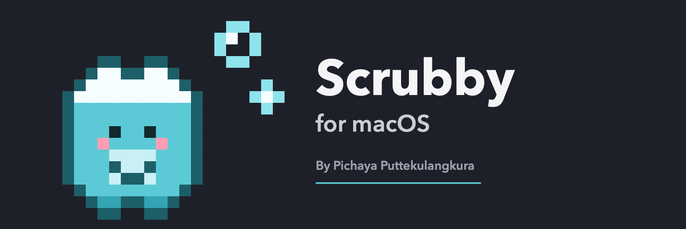
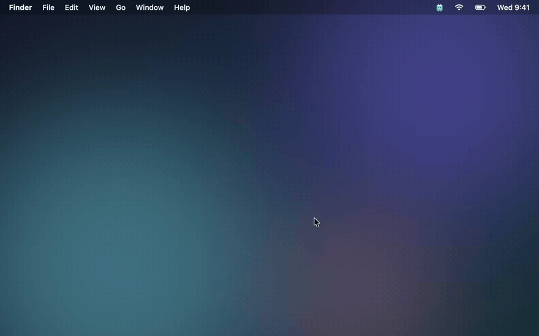

# Scrubby



[](LICENSE)
[](#install)
[](#install)
[](https://github.com/sponsors/mickyngub)
[](https://www.buymeacoffee.com/mickyngub)

<a href="https://www.buymeacoffee.com/mickyngub" target="_blank"></a>

Car wash mode for your Mac keyboard. Click the pixel critter in the menu bar, hit **Start cleaning**, and every key goes dead (⌘Tab, Spotlight, volume and media keys included) until you click **Done cleaning** with your trackpad or mouse. Wipe the crumbs away without typing a paragraph of `jjjjjjj` into whatever app was open.

## Demo



## What it does

- **Menu bar critter**: a teal pixel critter with a soap-foam cap. Click it for the panel; its critter frets until Scrubby has the Accessibility permission it needs.
- **Car wash screen**: a frosted overlay on every display with soap bubbles drifting up. Every key you press is caught and counted, and makes the critter hop.
- **Done cleaning**: click it with the trackpad or mouse, which keep working the whole time. A 5-minute failsafe unlocks the keyboard on its own.
- Follows the system light/dark appearance. It's a menu bar app with no Dock icon; if a crowded menu bar hides the critter behind the notch, launch Scrubby again from Spotlight or Raycast and the panel opens.

## Install

**Scrubby is distributed as source you build yourself.** There are no prebuilt downloads; see [why](#why-no-download) below.

Requires **macOS 14 (Sonoma) or newer** and a **Swift 5.9+ toolchain** (Xcode 15+, or just the Command Line Tools: `xcode-select --install`). No other dependencies.

```sh
git clone https://github.com/mickyngub/scrubby.git
cd scrubby
scripts/install.sh
```

`install.sh` checks for macOS 14+ and a Swift toolchain, builds (~40 s), moves any old copy to the Trash, installs to `/Applications`, and launches. No Gatekeeper warning: an app you compiled locally is never quarantined.

The first time you start cleaning, macOS asks for **Accessibility** access. Allow Scrubby under **System Settings › Privacy & Security › Accessibility**, then click **Start cleaning** again.

> **After a rebuild, toggle Scrubby off and on in that list.** macOS ties the grant to the app's exact code signature, and a locally built app is ad-hoc signed, so every build is a new identity. Settings keeps showing the old switch as on; it only counts again once you flip it.

### Why no download

A signed, notarized app needs an Apple Developer Program membership ($99/yr). Without one, any download lands quarantined and you'd have to click past *"macOS cannot verify this app is free of malware"*, for an app that then asks to control your keyboard. That is exactly the wrong thing to train people to do. Building from source avoids it, and you can read what you're running.

## How it works

- A `CGEventTap` at the HID level drops key down, key up and modifier events, plus the system-defined events behind the volume, brightness, media, eject and power keys. HID level rather than session level, so system shortcuts like ⌘Tab and Spotlight never fire either.
- Pointer events are never tapped, extra mouse buttons included: the mouse is the way out.
- While cleaning, Scrubby brings itself to the front so another app's password field lets go of Secure Event Input, which hides keys from every tap. If something keeps it on, the car wash screen warns you.
- If the app hangs or crashes, macOS drops the tap and your keyboard comes straight back.

## Limits

- A long press on the power button always shuts the Mac down; no app can block that.
- Secure Keyboard Entry left on by another app can let some keys through. You'll see the warning when it happens.

## Privacy & security

Scrubby makes no network connections, has no telemetry, and saves no files. The Accessibility permission is used for one thing: the key tap while cleaning mode is on. Key presses are counted, never recorded.

## Development

```sh
swift build
.build/debug/Scrubby --selftest                # key filter and critter checks, no permission needed
.build/debug/Scrubby                           # run it; the panel opens on its own
.build/debug/Scrubby --clean --unlock-after 5  # start cleaning right away, unlock after 5 s
scripts/bundle.sh                              # release build, assembled into build/Scrubby.app
scripts/record-demo.sh                         # re-record assets/scrubby-demo.gif (macOS 15+)
```

There is no XCTest target: the Command Line Tools ship without it, so `--selftest` is the test suite. The pixel critter, app icon and banner are all drawn from one 16×16 grid in [`Critter.swift`](Sources/Scrubby/Critter.swift).

Scrubby's look comes from its sibling app [Merly](https://github.com/mickyngub/merly), a menu bar tracker for AI coding agent quota.

## License

[MIT](LICENSE) © 2026 Pichaya Puttekulangkura
